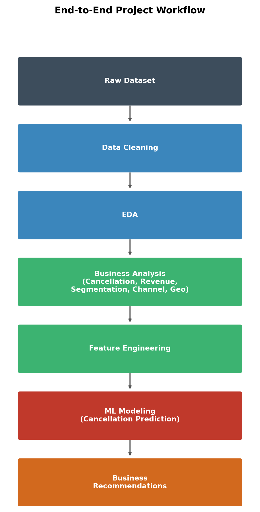
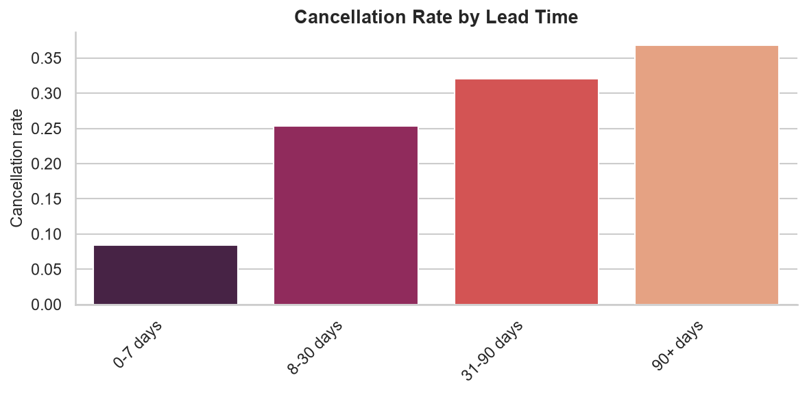
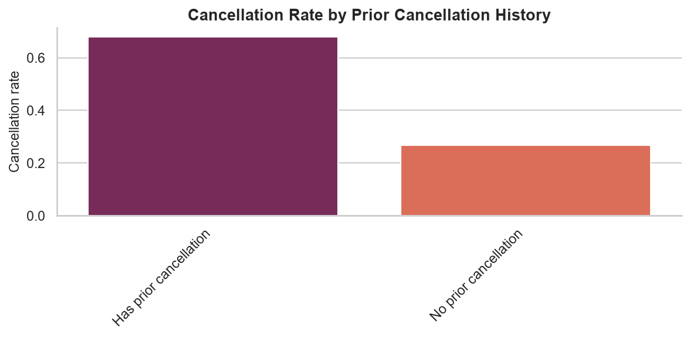
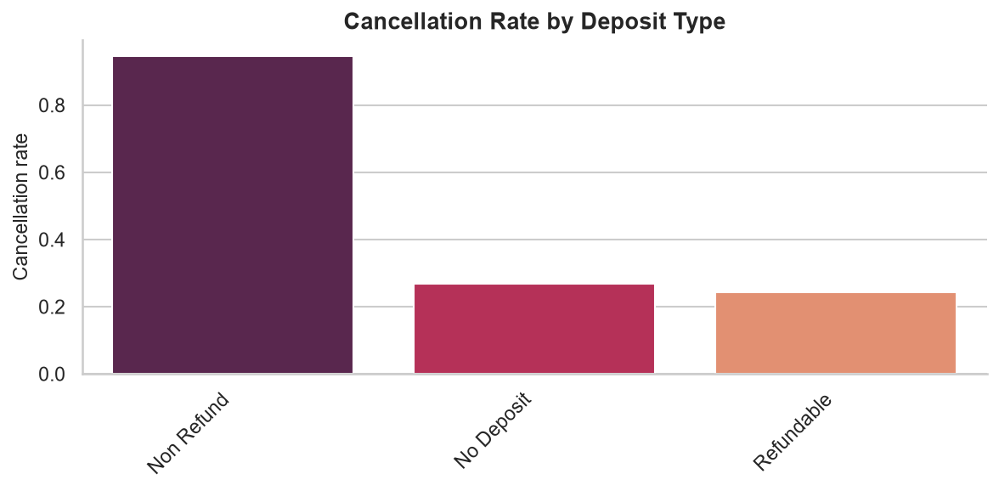
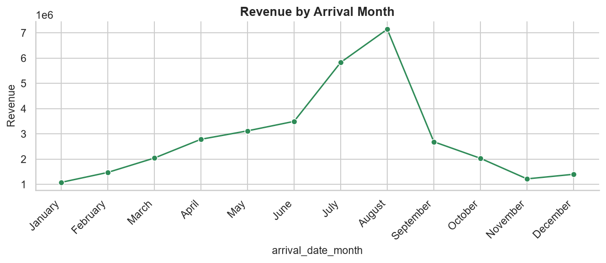
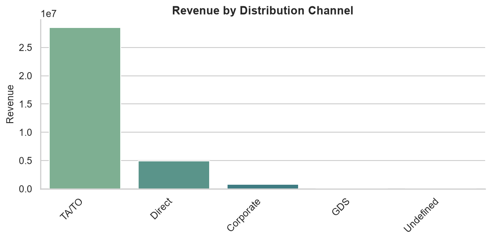

# 🏨 Hotel Booking Cancellation Analysis & Prediction

[](https://github.com/panteamkhh/hotel-cancellation-prediction/actions/workflows/ci.yml)
[](LICENSE)
[](https://www.python.org/downloads/)
[](https://github.com/psf/black)

An end-to-end, **Python-only** data analytics project on the **Hotel Booking
Demand** dataset: data cleaning, exploratory data analysis, business analysis,
and a machine-learning model that predicts cancellations at booking time.

Every result is produced by a reusable, tested function in `src/`, so the whole
report regenerates from the raw data with a single command — no BI tool required.

## Table of contents

- [Overview](#overview)
- [Business problem](#business-problem)
- [Dataset](#dataset)
- [Project workflow](#project-workflow)
- [Data cleaning](#data-cleaning)
- [Key findings](#key-findings)
- [Model performance](#model-performance)
- [Tech stack](#tech-stack)
- [Quick start](#quick-start)
- [Development](#development)
- [Project structure](#project-structure)
- [Key assumptions](#key-assumptions)
- [License](#license)

## Overview

A hotel chain (City Hotel & Resort Hotel) wants to understand customer booking
behavior, revenue drivers, cancellation patterns, and upselling opportunities.
This project cleans and analyzes ~119k booking records to answer those
questions, then builds a predictive model to flag high-risk cancellations
before they happen.

## Business problem

Cancellations create lost revenue and disrupt operational planning. This project
answers:

- What share of bookings get canceled, and does it vary by hotel type, country,
  or customer type?
- Which factors most strongly predict cancellation (lead time, deposit type,
  prior cancellations, etc.)?
- Which channels and customer segments generate the most (and most reliable)
  revenue?
- Can we predict, at booking time, whether a reservation is likely to be
  canceled?

## Dataset

- **Source:** [Hotel Booking Demand](https://www.kaggle.com/datasets/jessemostipak/hotel-booking-demand) (Kaggle)
- 119,390 raw rows, 32 columns — 87,139 rows remain after cleaning (see below)
- Covers bookings for a City Hotel and a Resort Hotel from 2015–2017
- Committed at `data/raw/hotel_bookings.csv` (16 MB) for full reproducibility;
  see [`docs/data_dictionary.md`](docs/data_dictionary.md) for every column

## Project workflow



Raw CSV → clean data → features → trained model, with each stage written to
disk and available both as a notebook and as a CLI command. See
[`docs/project_workflow.md`](docs/project_workflow.md) for the full breakdown.

## Data cleaning

Starting from 119,390 rows / 32 columns (`notebooks/01_data_cleaning.ipynb`,
`src/data_cleaning.py`):

- Dropped **31,994 exact duplicate rows**.
- Missing values: `children` (4 missing) filled with the mode; `company`
  (94% missing) dropped entirely; `agent` (16,340 missing) filled with
  `"no agent"`; `country` (488 missing) filled with the mode.
- Removed 257 invalid/outlier rows: bookings with zero total guests, negative
  ADR, and the top 0.1% of ADR outliers.
- Dropped `reservation_status` / `reservation_status_date` before modeling —
  they encode the outcome itself and would leak the target.
- **Result: 87,139 clean rows.** The cancellation rate shifts from a
  commonly-cited ~37% (on raw, duplicate-inflated data) to **27.5%** once
  duplicates are removed.

## Key findings

**Overall cancellation rate: 27.5%** after cleaning. City Hotel cancels more
than Resort Hotel (30.1% vs 23.5%).

**Lead time is the strongest behavioral signal** — bookings made 90+ days ahead
cancel at **4.4x** the rate of bookings made within a week (36.9% vs 8.4%).
Canceled bookings have a median lead time of 80 days vs 38 days for completed
stays.



**Prior history matters a lot:** guests with a previous cancellation on record
cancel again 68.0% of the time, vs 26.7% for guests with no such history.



**Deposit type is a red flag, not a safeguard here:** `Non Refund` bookings
cancel 94.7% of the time — far higher than `No Deposit` (26.7%) or `Refundable`
(24.3%). In this dataset, non-refundable deposits are strongly associated with a
specific high-risk booking channel rather than acting as a deterrent.



**Demand and revenue are both seasonal**, peaking in August (11,186 bookings,
~$7.1M revenue) and lowest in January (4,685 bookings, ~$1.1M revenue). Total
revenue across the cleaned dataset: **~$34.3M**, split $18.7M (City Hotel) /
$15.6M (Resort Hotel).



**Revenue is geographically concentrated:** Portugal, the UK, and France alone
account for 53.9% of all bookings; Portugal alone drives ~$9.1M in revenue.
`TA/TO` (travel agent / tour operator) is the dominant distribution channel —
68,974 bookings and $28.5M in revenue — but also carries the highest
cancellation rate among channels with meaningful volume (30.9%).



**Business-style vs. vacation-style bookings behave very differently:** short,
weekday-heavy, short-lead-time stays ("business traveler" pattern, ~19.7% of
bookings) cancel at 13.9%, while longer, weekend-heavy stays ("vacation
traveler" pattern, ~14.9% of bookings) cancel at 31.2% and pay a higher average
rate (113 vs 95 ADR).

See [`reports/final_report.md`](reports/final_report.md) for the full write-up
and [`reports/figures/`](reports/figures) for all 18 charts.

## Model performance

Trained on the feature-engineered dataset (87,139 rows → 573 columns after
one-hot encoding), 80/20 stratified train-test split:

| Model | Precision | Recall | F1-score | ROC-AUC |
|---|---|---|---|---|
| Logistic Regression (baseline) | 0.692 | 0.549 | 0.612 | 0.871 |
| Random Forest | 0.783 | 0.628 | 0.697 | 0.910 |
| XGBoost | 0.760 | 0.689 | 0.723 | 0.919 |
| **LightGBM (best)** | **0.762** | **0.697** | **0.728** | **0.922** |

**LightGBM wins on every metric except precision** (Random Forest is marginally
more precise but misses far more actual cancellations). The strongest predictors
of cancellation are lead time, deposit type, country, and prior cancellation
history. See [`docs/model_card.md`](docs/model_card.md) for intended use,
limitations and ethical notes.

## Tech stack

- **Language:** Python 3.10+
- **Analysis:** pandas, numpy
- **Visualization:** matplotlib, seaborn
- **Machine learning:** scikit-learn, XGBoost, LightGBM
- **Environment:** Jupyter Notebook
- **Tooling:** pytest, ruff, black, pre-commit, GitHub Actions, Make

## Quick start

```bash
git clone https://github.com/panteamkhh/hotel-cancellation-prediction.git
cd hotel-cancellation-prediction

python -m venv venv
source venv/bin/activate      # Windows: venv\Scripts\activate
pip install -r requirements.txt
```

The raw CSV is committed, so there is no download step.

**Option A — step through the notebooks** (recommended for exploring the
analysis):

```bash
pip install -r requirements-dev.txt
jupyter notebook notebooks/01_data_cleaning.ipynb
```

Run the notebooks in order (01 → 09); see
[`notebooks/README.md`](notebooks/README.md) for what each one does.

**Option B — reproduce everything with CLI commands:**

```bash
python -m src.run_pipeline    # clean -> features -> train LightGBM -> evaluate
python -m src.run_analysis    # regenerate all 18 figures + output/ tables
python -m src.train           # fit and compare all four models
```

Installed as a package, the same commands are available as `hotel-pipeline`,
`hotel-analysis` and `hotel-train`.

## Development

```bash
pip install -r requirements-dev.txt
pre-commit install

ruff check .              # lint
black --check .           # formatting
pytest                    # tests (36 tests covering src/)
pytest --cov=src          # tests with coverage
make check                # all of the above at once
```

CI runs lint, format checks and the test suite on Python 3.10–3.12. See
[`CONTRIBUTING.md`](CONTRIBUTING.md) for details.

## Project structure

```
hotel-cancellation-prediction/
├── data/
│   ├── raw/                       # raw CSV + provenance note
│   └── processed/                 # clean + feature-engineered CSVs
├── notebooks/                     # 01-09, one per phase, fully executed
│   └── README.md                  # what each notebook does
├── src/                           # reusable package
│   ├── config.py                  # paths and constants
│   ├── data_loader.py             # loading + schema validation
│   ├── data_cleaning.py           # cleaning pipeline
│   ├── feature_engineering.py     # feature pipeline
│   ├── analysis.py                # one function per business question
│   ├── visualization.py           # matching chart for each question
│   ├── theme.py                   # shared chart theme
│   ├── evaluation.py              # model evaluation helpers
│   ├── train.py                   # model comparison CLI
│   ├── predict.py                 # score new bookings
│   ├── run_pipeline.py            # clean -> features -> train CLI
│   └── run_analysis.py            # regenerate figures + exports CLI
├── tests/                         # pytest suite (36 tests)
├── models/                        # best_model.pkl + model_metrics.json
├── reports/
│   ├── figures/                   # 18 charts
│   └── final_report.md            # written findings + recommendations
├── docs/                          # data dictionary, model card, workflow
├── output/                        # generated CSV exports (gitignored)
├── .github/workflows/ci.yml       # lint + format + test CI
├── Makefile                       # common tasks
├── pyproject.toml                 # metadata, deps, tool config
├── requirements.txt               # runtime dependencies
└── requirements-dev.txt           # runtime + dev dependencies
```

## Key assumptions

- `revenue = adr * (stays_in_weekend_nights + stays_in_week_nights)` — the
  dataset has no separate revenue column, so this is the standard derived proxy
  used across published analyses of this dataset.
- Rows with zero total guests (adults + children + babies = 0) are treated as
  invalid bookings and removed, not analyzed as a special segment.
- "Business traveler" / "vacation traveler" segments (notebook 05) are
  rule-based heuristics (stay length, weekend-night share, lead time), not a
  field in the source data — they're a simplification for segmentation, not
  ground truth.
- `reservation_status` and `reservation_status_date` are excluded from modeling
  as target leakage: they record the outcome itself, which isn't known at
  booking time.

## License

MIT — see [LICENSE](LICENSE).
