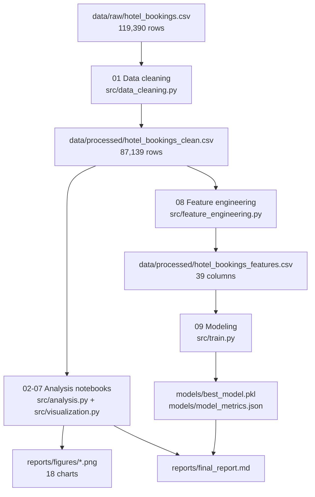

# Project workflow

The project is a straight pipeline: each stage writes an artifact that the
next stage reads, and every stage is available both as a notebook (to explore)
and as a reusable function in `src/` (to reproduce).



## Stage by stage

| Stage | Notebook | Module | Output |
|---|---|---|---|
| Load + validate | — | `src/data_loader.py` | validated DataFrame |
| Clean | `01_data_cleaning.ipynb` | `src/data_cleaning.py` | `hotel_bookings_clean.csv` |
| EDA | `02_eda.ipynb` | `src/analysis.py`, `src/visualization.py` | figures 01–05 |
| Cancellation analysis | `03_cancellation_analysis.ipynb` | same | figures 06, 10–14 |
| Revenue analysis | `04_revenue_analysis.ipynb` | same | figures 07, 15–17 |
| Segmentation | `05_customer_segmentation.ipynb` | same | profile tables |
| Booking behavior | `06_booking_behavior.ipynb` | same | figures 08–09 |
| Channel & geography | `07_channel_geo_analysis.ipynb` | same | figure 18 |
| Feature engineering | `08_feature_engineering.ipynb` | `src/feature_engineering.py` | `hotel_bookings_features.csv` |
| Modeling | `09_modeling.ipynb` | `src/train.py`, `src/evaluation.py` | `best_model.pkl`, metrics |

## One-command reproduction

```bash
python -m src.run_pipeline    # clean -> features -> train LightGBM -> evaluate
python -m src.run_analysis    # regenerate all 18 figures + output/ tables
python -m src.train           # fit and compare all four models
```

Notebooks call the exact same `src/` functions, so the notebooks and the CLI
cannot drift apart.
